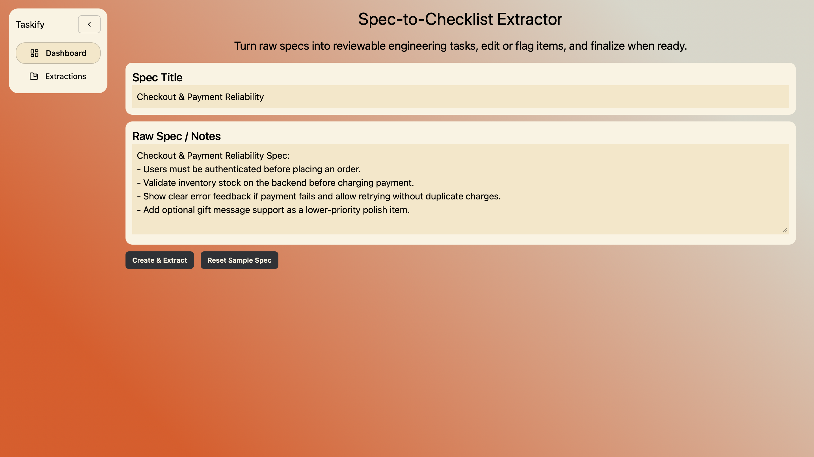
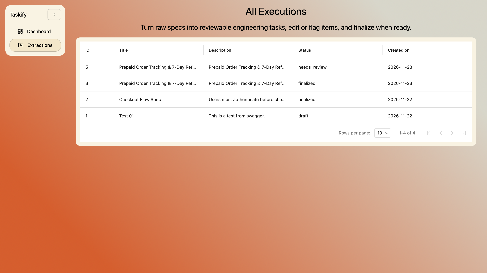
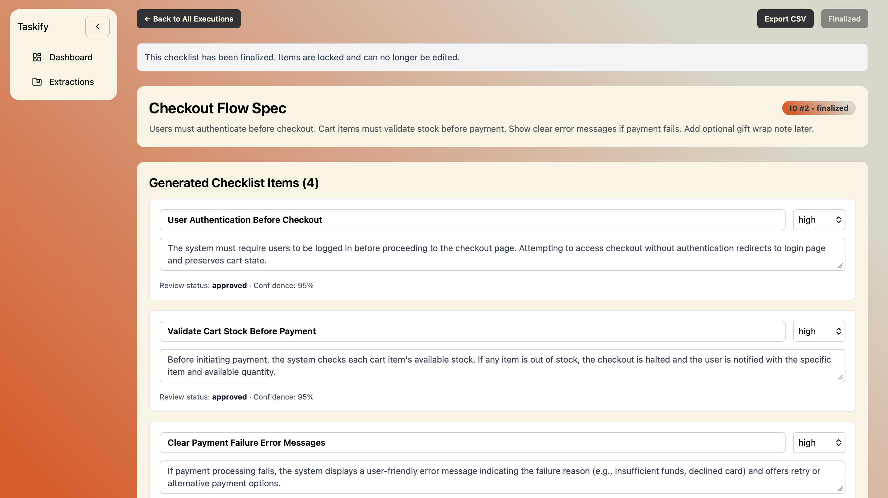
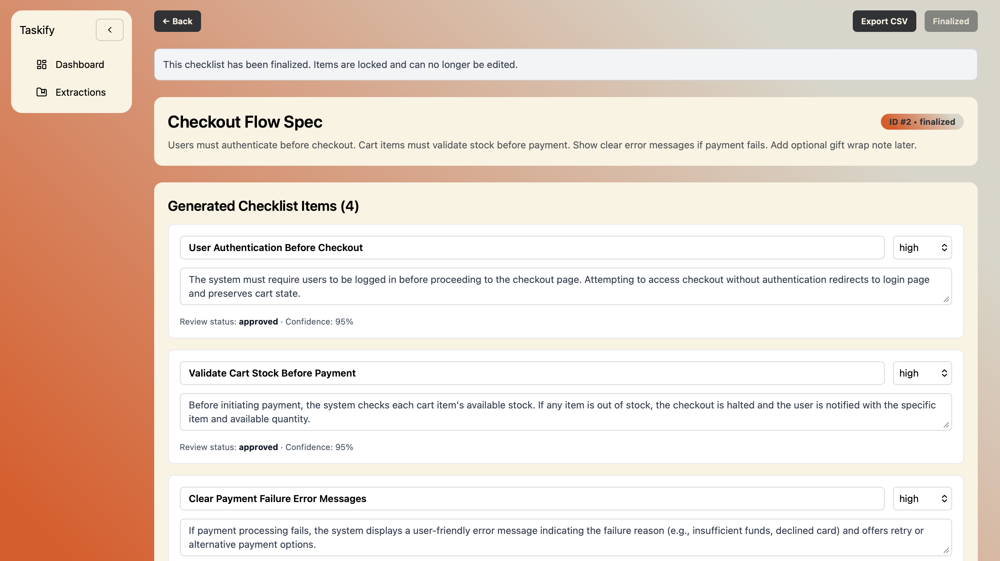

# Spec-to-Checklist Extractor

An AI-powered full-stack engineering workflow tool that transforms raw product specs and meeting notes into structured, reviewable engineering checklists with testable acceptance criteria, priority levels, and confidence scores.

## Architecture Overview

```text
React + TypeScript (Frontend)
        │  REST JSON (/api/*)
        ▼
FastAPI + Pydantic (Backend)
   ├──► Groq LLM API (Strict JSON Schema Structured Extraction)
   └──► SQLAlchemy ORM ──► Psycopg ──► PostgreSQL (Supabase)
```

## Key Features

- **Structured AI Extraction:** Uses Groq's strict `json_schema` mode to extract engineering tasks with titles, testable acceptance criteria, priority (`low`, `medium`, `high`), and confidence scores.
- **Human-in-the-Loop Review Workflow:** Inline editing for task titles, priorities, and acceptance criteria, with item-level review states (`pending_review`, `needs_edit`, `approved`).
- **Finalization & Locking:** Enforces approval across all checklist items before locking an execution (`finalized`), preventing accidental post-sign-off edits on both the client and API layers.
- **One-Click Exports:** Export checklists as escaped **CSV** files or copy formatted **GitHub-flavored Markdown** task lists directly to the clipboard.

## Screenshots & UI Walkthrough

### 1. Spec Ingestion & AI Extraction

Submit raw product specs or meeting notes to generate structured engineering tasks via Groq.


### 2. Execution History Table

Browse, sort, and paginate across all past extraction runs and inspect their current review status.


### 3. Human-in-the-Loop Checklist Review

Edit generated task titles, priorities, and acceptance criteria inline, and mark items as **Approved** or **Needs Edit**.


### 4. Finalized & Locked State + Exports

Once all items are approved, finalize the checklist to lock edits and export the tasks as **CSV**.


## Tech Stack

| Layer              | Technologies                                                                    |
| :----------------- | :------------------------------------------------------------------------------ |
| **Frontend**       | React, TypeScript, Vite, Tailwind CSS, React Router, React Data Table Component |
| **Backend**        | Python, FastAPI, Pydantic v2, SQLAlchemy ORM, Psycopg 3                         |
| **Database**       | PostgreSQL (Supabase)                                                           |
| **AI Integration** | Groq SDK (Structured Outputs / JSON Schema)                                     |

## Repository Structure

```text
├── backend/          # FastAPI application, SQLAlchemy models, Pydantic schemas, Groq service
│   └── README.md     # Backend setup, environment variables, and API reference
├── frontend/         # React + TypeScript UI, execution table, review & export views
│   └── README.md     # Frontend setup, routing, and build instructions
└── README.md
```

## Quick Start

1. **Start the Backend:** Follow [`backend/README.md`](./backend/README.md) to configure `.env` and run `uvicorn app.main:app --reload` on `http://localhost:8000`.
2. **Start the Frontend:** Follow [`frontend/README.md`](./frontend/README.md) to configure `VITE_API_BASE_URL` and run `npm run dev` on `http://localhost:5173`.
